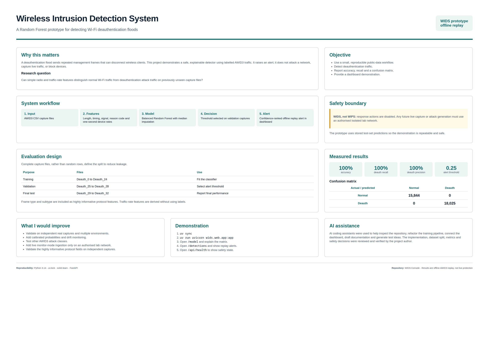

# Wireless Intrusion Detection System

This project uses a scikit-learn Random Forest model to detect
deauthentication traffic in the AWID3 wireless dataset. A trained model is included.

## Quick setup

These steps run the included trained model and dashboard without the raw dataset:

```bash
git clone https://github.com/kakeetopius/wids.git
cd wids
uv sync
uv run uvicorn wids.web.app:app --host 127.0.0.1 --port 8000
```

Open <http://127.0.0.1:8000>. Stop the server with `Ctrl+C`.

## Run the existing trained model

Requirements:

- Linux, macOS, or Windows
- Python 3.14
- [uv](https://docs.astral.sh/uv/)

Install the exact locked dependencies:

```bash
git clone https://github.com/kakeetopius/wids.git
cd wids
uv sync
```

Start the dashboard:

```bash
uv run uvicorn wids.web.app:app --reload
```

Open <http://127.0.0.1:8000>.

- `/` — project overview
- `/model` — accuracy, precision, recall, F1-score, and confusion matrix
- `/dataset` — dataset summary and evaluation split
- `/detections` — top alerts from the offline test replay

```text
models/deauth_model.joblib
```

## Reported test result

The included model was evaluated on capture files that were not used for
training or threshold selection:

| Metric                     | Result |
| -------------------------- | -----: |
| Accuracy                   | 100.00% |
| Deauthentication precision | 100.00% |
| Deauthentication recall    | 100.00% |
| Deauthentication F1-score  | 100.00% |

Confusion matrix:

| Actual / predicted | Normal | Deauth |
| ------------------ | -----: | -----: |
| Normal             | 15,844 |      0 |
| Deauth             |      0 | 18,025 |

The Detections page displays predictions from this offline test replay. It does not capture live wireless traffic or automatically block devices.

## Optional: retrain the model

Retraining is not required to run the dashboard. To reproduce or change the
model, obtain the same AWID3 CSV release and place the deauthentication files
in:

```text
CSV/1.Deauth/
```

The trainer expects files named like `Deauth_0.csv` through `Deauth_32.csv`,
with a `Label` column containing `Normal` and `Deauth`.

Run:

```bash
uv run python -m wids.train
```

The model uses capture-file groups:

- Training: files outside the validation and test groups
- Validation: `Deauth_25.csv` through `Deauth_28.csv`
- Final test: `Deauth_29.csv` through `Deauth_32.csv`

The model includes `wlan.fc.type` and `wlan.fc.subtype` as protocol features.
These fields are highly informative for this AWID3 task and explain the
perfect held-out score; the result should not be interpreted as evidence that
the detector will generalise perfectly to every live wireless environment.
The trainer also derives one-second overall, source, and destination
traffic-rate features.

## A1 poster


